<div align="center">



<br/><br/>


# PDVR GAMING — Virtual Reality Gaming Experience

[](https://pdvrgaming.github.io/)
[](https://react.dev/)
[](https://www.typescriptlang.org/)
[](https://tailwindcss.com/)
[](https://vitejs.dev/)
[](https://wa.me/919133020759)

</div>

🎮 **Step Into Virtual Reality** — Experience immersive VR gaming with our premium collection of virtual reality games. From high-speed 360° roller coasters and superhero flights to curriculum-aligned STEM expeditions and turnkey mobile event setups across **Vijayawada, Guntur, Amaravati, and Andhra Pradesh**.

🌐 **Official Website:** [https://pdvrgaming.github.io/](https://pdvrgaming.github.io/)  
🏥 **Health Tech Sister App (MEDIC PWA):** [https://pdvrgaming.github.io/medic/](https://pdvrgaming.github.io/medic/)

---

## 🚀 VR Experience Catalog

### 🎢 360° Adrenaline Rides (`₹100 – ₹150` · 5 – 10 Mins)
- **Roller Coaster** (`₹100`): Full 360-degree immersive rollercoaster tracks with heart-pounding loops and drops.
- **Santa Ride** (`₹100`): Magical festive sleigh ride through starlit skies and snowy landscapes.
- **Henry** (`₹100`): Emmy award-winning heartwarming VR narrative about a lovable hedgehog.
- **Jurassic Park** (`₹150`): Walk among dinosaurs and face a towering T-Rex in dense primeval jungles.

### 🔥 VR Gaming Action (`₹150` · 5 – 10 Mins)
- **Beat Saber:** Slice neon beats to high-energy music with dual energy sabers.
- **Iron Man:** Soar through city skies with repulsor hand thrusters and high-tech aerial combat.
- **Richie's Plank:** The ultimate courage test 80 storeys above city traffic on a narrow plank.
- **Boxing:** Physics-based championship boxing matches and full-body cardio workout.
- **Horror:** Spine-chilling paranormal suspense and jump scares in 360 darkness.
- **Cricket:** Face 140+ km/h pace bowling and spin variations in packed virtual stadiums.

### 🌌 Educational & STEM Modules (`₹300` · 15+ Mins)
- **Solar System:** Astronomical journey through planetary orbits, rings, moons, and solar eclipses.
- **Ocean Rift:** Deep-sea aquatic safari swimming with dolphins, whales, and prehistoric marine life.
- **Mission ISS:** NASA-guided microgravity spacewalk and life aboard the International Space Station.
- **Anatomy:** Interactive 3D dissection of human organs, circulatory, and skeletal systems.

### 🎪 Turnkey Event Setups
- **Apartment Carnivals & Society Days:** Multi-station setups with safety perimeter mats and queue management.
- **School STEM Workshops:** Interactive science sessions vetted for students.
- **Private Birthday Arenas:** 2–3 hour dedicated gaming sessions with party hosts.

---

## 📱 Contact & Operations

- **Phone:** [+91 9133020759](tel:+919133020759)
- **WhatsApp:** [+91 9133020759](https://wa.me/919133020759)
- **Email:** [gamingpdvr@gmail.com](mailto:gamingpdvr@gmail.com)
- **Location:** Vijayawada, Guntur, Amaravati & Andhra Pradesh
- **Hours:** 8:00 AM – 10:00 PM (Monday – Sunday)

---

## 📂 Branches & Deployment

- **`source` branch:** Editable React 19 + TypeScript + Vite source codebase (`src/`, `public/`, `index.html`).
- **`main` branch:** Production minified build (`dist/`) served directly at **[https://pdvrgaming.github.io/](https://pdvrgaming.github.io/)**.

```bash
# Develop locally
npm install --legacy-peer-deps
npm run dev

# Rebuild and deploy updated dist/ to origin/main
npm run deploy
```

---

© 2026 PDVR Gaming. All rights reserved.
